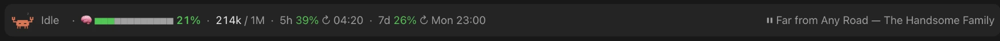

# turbiv-claude-plugins

Plugins for [Claude Code](https://code.claude.com). A plugin adds commands, hooks or both to Claude Code;
you install only the ones you want. This repo is a plugin marketplace: you add it once, then install
plugins from it.

## Plugins

| Plugin | What it does | How to use it |
|---|---|---|
| [flow](plugins/flow/README.md) | Takes a goal to an approved, binding spec, with one decision table and an always-on validator | `/flow:start <goal>`, then `/flow:status` to resume. Each stage also runs alone |
| [context-band](plugins/context-band/README.md) | Band above the prompt in the Claude apps: what the session is running (a pixel crab acts it out), context fill, plan usage (5h/7d) or USD, and Spotify's current track | Nothing to run: it shows once installed. Apps only, not the terminal |
| [kanban](plugins/kanban/README.md) | A kanban board of your work streams that updates itself from your Claude sessions. Each card says where you left off and what comes next | `/kanban:setup` once, then `/kanban:sync` to update and `/kanban:board` to ask or change |

Each plugin's README says what it needs and how to use it. Read it before installing.

context-band in the desktop app, with nothing running:



## Install

Run these in Claude Code. First add the marketplace (once per machine):

```text
/plugin marketplace add turbiv/turbiv-claude-plugins
```

Then install the plugin you want:

```text
/plugin install flow@turbiv-claude-plugins
```

```text
/plugin install kanban@turbiv-claude-plugins
```

```text
/plugin install context-band@turbiv-claude-plugins
```

Start a new Claude Code session, and the plugin's commands and hooks are on. To see, turn off or remove plugins, run
`/plugin`.

## Update

```text
/plugin marketplace update turbiv-claude-plugins
```

Then update the plugin from `/plugin`.

## For plugin developers

**Load a plugin straight from a checkout** to try changes without reinstalling: add its folder to
`CLAUDE_CODE_PLUGIN_DIRS` in the `env` block of `~/.claude/settings.json`, separating several folders with
`:`. Changes apply to the next session.

```json
{
  "env": {
    "CLAUDE_CODE_PLUGIN_DIRS": "~/git/turbiv-claude-plugins/plugins/flow"
  }
}
```

**Add a plugin:**

1. Make `plugins/<name>/.claude-plugin/plugin.json`, a `README.md`, and the plugin's `skills/`, `agents/`,
   `commands/` or `hooks/` folders.
2. Add an entry to `plugins` in `.claude-plugin/marketplace.json` with `"source": "./plugins/<name>"`.
3. Add a row to the table above.
4. Run `claude plugin validate .` from the repo root.
