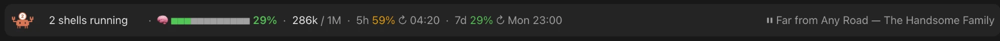
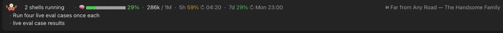
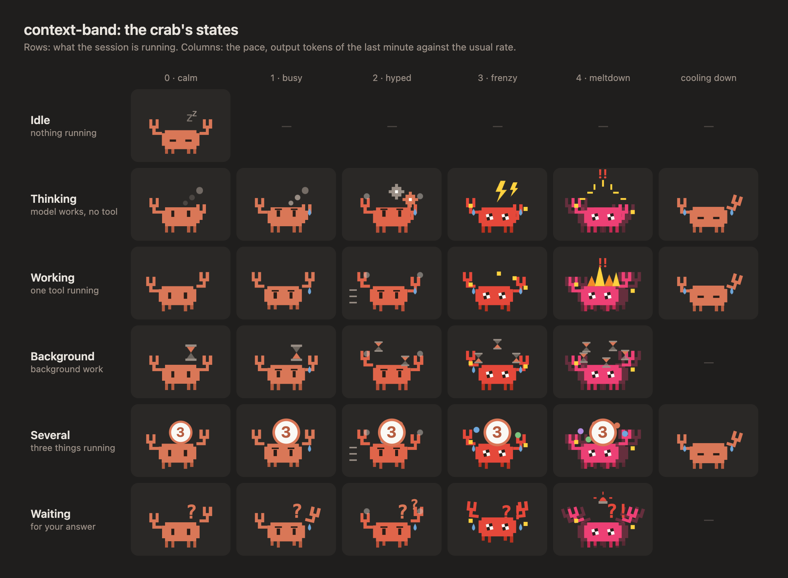

# context-band

A band above the prompt in the Claude apps (desktop, VS Code, mobile).



With the count opened, the band lists each thing that runs:



It shows:

- **What the session is running**, first, so you can tell a working session from an idle one. A small pixel crab acts it out (desktop and mobile; hover it and it waves; every few seconds it snaps its right claw; click it to poke it: it flinches, eyes wide under a `!`, and does a moment of its own act — the z's pop and it rubs an eye, it points down at the prompt when it waits on you, its thoughts scatter, sparks fly off the nail, the factory's needle slams into the red, the baton is fumbled; keep poking and from the third poke in a row it frowns and steams, from the fifth it turns red, glares and snaps its claw at you; after a few seconds without a poke it forgets):
  - a turn just ended: for five minutes the crab stays awake and waits on you, restless: it looks left, right and down at the prompt, taps its feet and beckons with its left claw, all to the pace of that turn (hopping from frenzy) as it winds down, `Idle`;
  - nothing, for five minutes or more: the crab sleeps tucked in, claws on the ground, breathing slowly under drifting z's, `Idle`;
  - the model thinking: it paces sideways back and forth, claw on its chin, thought dots going with it;
  - one tool: it hammers a nail on a block beside it, sparks flying on each strike;
  - only background work left: it cranks a little factory, its gauge swinging, the furnace glowing, a puff of smoke now and then;
  - waiting for your answer: it holds a magnifying glass up to its eye (the lens shows the eye twice its size, and it blinks), lowers it and a `?` pops up;
  - several things: it conducts them with a baton under a badge with the count, faster the more things run (a bar of four beats takes 2 s for two, down to 0.9 s from six); the count beside it opens a list of each one.

  Beside the crab, one thing reads as a few words for it: the Bash call's description (`Running the tests`), `Reading foo.ts`, `Agent: review the diff`, or `Thinking` while the model works with no tool running. Several read as how many and of what kinds, `3 running: 2 shells, 1 agent`.

  It counts the main turn's tool calls in flight and the background work that outlives them (background shells, subagents, monitors, workflows). Background work shows from the call that starts it (asked for, or moved there with ctrl+b) and leaves as soon as Claude Code reports it ended (completed, failed or stopped); the whole list is also refreshed at the end of each turn from the list Claude Code keeps of work still in flight.
- **How hard the session works**, acted out by the same crab in every mood but sleep. The pace is the output tokens (the answer, the thinking and the tool calls, subagents' too) of the last minute against the usual rate for the model:
  - 0, normal: the crab as above;
  - 1, busy (about 1.5x the usual): worried brows and a sweat drop, and every act goes faster: the walk, the hammer, the conducting, the crank; the waiting crab looks through its glass more nervously, the glass shaking and the eye blinking twice, and taps its foot;
  - 2, hyped (2x): steam; while thinking, gears turn in its head; at work it wipes its brow between strikes; the factory smokes more and money shows in its furnace; waiting, it puts the glass away, waves, hops and two `?` appear;
  - 3, frenzy (3x): it turns red and jitters, its eyes spin and sparks fly; thinking brings lightning; at work a second hammer strikes a second block in turn; the factory belches dark smoke and burns money, bills flying out of the chimney as ash; waiting, it jumps with both claws up and the `?` becomes `?!`;
  - 4, meltdown (4x or more): rainbow colours and ghost crabs, which act along; `!!` and red-hot nails at work, rays from its head while thinking, the factory's chimney on fire with money pouring out, a flashing siren on its head while waiting;
  - when the pace falls back from hyped or more, a crab at work, thinking or running several things pants and fans itself for a few seconds, then comes down one level at a time.

  Waiting and background work spend no tokens of their own, so their level is the pace as it fell just before: a question asked in the middle of a burst is asked in a hurry, and the crab calms as the minute passes.

  

  The usual rate is learned, not set: only minutes in which the model actually wrote count, a burst counts for at most three times the usual rate, and each model has its own. It is kept between sessions in the plugin's own store (a small JSON file under your Claude Code configuration folder: numbers only, no prompts or replies). Until the band has seen a model for a few minutes, it uses a guess of 2,500 tokens a minute. The level reads the stream as it arrives (about 4 characters to a token) and settles on the API's own count when each response ends.
- **Context fill**: a 12-cell bar and percent, green below 40%, amber from 40%, red from 85%, then tokens used of the window.
- **What you spend**, decided per session from what the API reports:
  - on a Pro/Max subscription (its responses carry the 5-hour and 7-day windows): those windows, and when each resets;
  - on usage billing (an API key, or a pay-per-use Team/Enterprise seat signed in with claude.ai): the session's cost in USD,
    an estimate.

  A claude.ai login shows neither until its first response says which it is.
- **Spotify's current track** (macOS only), on the right. It asks Spotify only when it is already running, every 5 seconds, so it never launches it.

In a terminal session the band draws nothing and does not poll Spotify; the terminal keeps its own status line.

## Install

```text
/plugin marketplace add turbiv/turbiv-claude-plugins
/plugin install context-band@turbiv-claude-plugins
```

Then `/reload-plugins` or start a new session.

## Develop

Run the tests from the repo root:

```sh
claude plugin test plugins/context-band
```

After changing the band, raise `version` in `.claude-plugin/plugin.json`, then
`claude plugin update context-band@turbiv-claude-plugins` and `/reload-plugins`: a session runs the installed copy, not
this folder. To skip reinstalling while you work, load it from the checkout with `CLAUDE_CODE_PLUGIN_DIRS` (see the
repo README).
