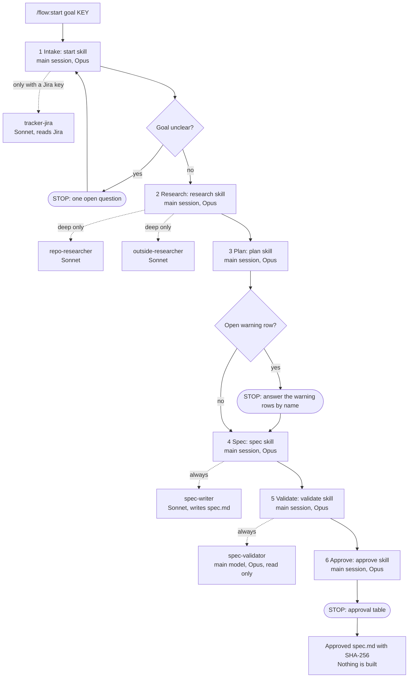

# `flow`: overview

`flow` takes a goal to an approved, binding spec. It does not build anything. Version 1.

This page describes the plugin at `e386a96` on branch `claude/flow-g-review-f5ba47` (version 1 plus the
review fixes). That branch is not merged yet.

## The flow

The main session runs every skill on its own model (Opus by default). Dotted lines are subagents.
Rounded boxes are stops: the run waits for your reply.

- **Stop 1** comes only when the goal can mean different outcomes, or to ask a yes for deep research.
- **Stop 2** comes only when the plan has a ⚠ row (it changes your request or the scope).
- **Stop 3** always comes.
- Quick research: the main session reads the code itself, with at most one built-in Explore subagent.

## The subagents

Each subagent starts fresh. It gets only the fields in its prompt.

| Agent | Gets | Does not see | Tools | Model |
|---|---|---|---|---|
| `repo-researcher` | The research questions, repo paths | The goal, item ID, ticket, item folder, chat. Skips `work-items/` | Read, Glob, Grep | Sonnet |
| `outside-researcher` | The research questions | The goal, item ID, ticket, repos, chat. No internal names in web queries | WebSearch, WebFetch, Jira and Confluence read | Sonnet |
| `spec-writer` | The item folder, the rules folder | The chat, the repos | Read, Glob, Grep, Write (`spec.md` only) | Sonnet |
| `spec-validator` | Paths of `spec.md`, `decisions.md`, repos, rules | The chat, `CLAUDE.md`, `plan.md`, `research/`, `item.md` | Read, Glob, Grep | Main model (Opus) |
| `tracker-jira` | Item folder path, Jira key | Repos | Read, Write (`mirror/` only), 3 Jira read tools | Sonnet |

Why the blinds: a researcher that knows the goal finds the code it wants, not the code that exists. A
validator that reads the plan fills gaps that the builder later cannot fill.

The "only" limits on Write are in the agent text. Claude Code does not enforce them.

## The skills

| Command | Does |
|---|---|
| `/flow:start <goal> [KEY] [depth=none\|quick\|deep]` | Intake: reads the code, sizes the task (S, M, L), asks open questions only when needed. Then runs the stages below in order |
| `/flow:research <item>` | Research at depth none, quick or deep. Writes `research/` |
| `/flow:plan <item>` | Writes `plan.md` and decision rows. Shows a summary of 10 lines or fewer |
| `/flow:spec <item>` | The spec writer writes `spec.md`. Its guesses become decision rows |
| `/flow:validate <item \| path>` | The validator checks the spec: `READY` or `NOT READY`. Small fixes are made; other findings become rows |
| `/flow:approve <item>` | Shows the plan summary, the Done lines and one decision table. Records your approval |
| `/flow:status [item]` | Stage, open rows, next step. Use it to resume in a new session |
| `/flow:mirror <item> pull\|push` | `pull` reads the Jira ticket into `mirror/`. `push` only says "version 2" |

Every stage skill also runs alone with an item ID. It checks that the files of the stage before it exist.

## How to use it

- **Start:** `/flow:start <goal>`. Add a Jira key to read the ticket. Add `depth=deep` for deep research.
- **Reply at a stop:** `ok` accepts the recommended rows and the rows "made by me". It never accepts a ⚠
  row. Answer a ⚠ row by name: `D1 ok` or `D1 B`. `D4: <text>` changes a row. `explain D2` discusses one.
- **Short table:** the chat shows ⚠ rows and build choices in full. Check details and small validator
  fixes fold into one line. Say `show` to list them. `decisions.md` keeps every row.
- **Resume:** in a new session, `/flow:status <item>`, then `/flow:start <item ID>`.

## Where the files go

The work store is the first match of:

1. `FLOW_WORK_ITEMS` (set it in the `env` block of `~/.claude/settings.json`);
2. `EVAL_FLOW_WORK_ITEMS` (eval runs only, a path relative to the working folder);
3. `~/git/turbiv-claude-plugins/work-items`.

Without a shell: `./work-items/` if Glob finds it, else the default path.

One folder per item: `<store>/<yyyymmdd>-<slug>/` with `item.md`, `research/`, `plan.md`,
`decisions.md`, `spec.md`, `validation.md`, `log.md`, `mirror/`. Each stage commits its item folder only.
It never pushes.

To stop the permission prompts, allow: `Bash(printenv FLOW_WORK_ITEMS)`,
`Bash(printenv EVAL_FLOW_WORK_ITEMS)`, `Bash(git log:*)`, `Bash(git -C:*)`, `Bash(tail:*)`,
`Bash(shasum:*)`.
Also add the work store to `permissions.additionalDirectories`. Without it, the spec hash at approval
asks first (or, if denied, approval records `sha256:unavailable`).

## What version 1 does not do

- No Jira writes. Jira is read at intake (with a key) and on `/flow:mirror pull` only.
- No build. The flow ends at the approved spec.
- No hooks. "Nothing built before approval" is in the skill text only.
- Not yet tried in a real run: deep research, and a live Jira pull.

Cost of one S trial run (after the review fixes): $7.02, 21.5 minutes, 2 replies from you.

More: the design is [`../design/pre-implementation-stages.md`](../design/pre-implementation-stages.md).
Development notes are in [`dev-notes.md`](dev-notes.md).
