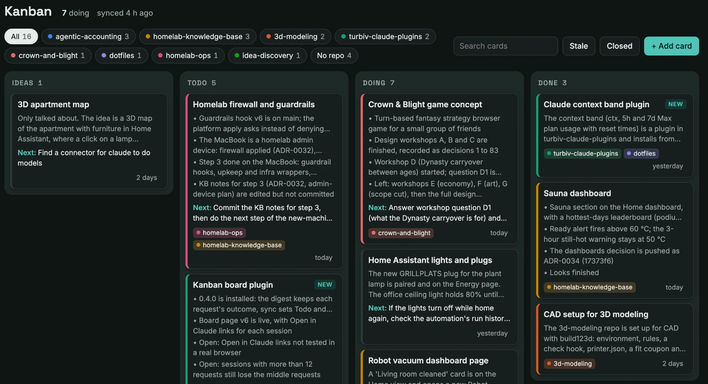

# kanban

A kanban board of your work streams that updates itself from your Claude sessions. Each card says where
you left off and what comes next. Cards you have not touched for a while stand out.

The board is a page on claude.ai (an artifact). You open it by its link, on any device. Claude keeps it
current: a small hook notes each session, and a sync turns the sessions into card updates.



## What you get

- **A board** with four columns: Ideas, Todo, Doing, Done. One card is one lasting work stream, such as
  "Sauna dashboard". Small steps are lines in the card's history.
- **Two ways to close a card:** Done (finished) and Won't do (given up). Won't do and Archived cards are
  hidden until you turn on the "Closed" switch.
- **On each card:** where it stands, the next step, what was done lately, the repos it touched, links,
  and the Claude sessions behind it. "Open in Claude" opens a session in the desktop app
  (`claude://resume?session=<id>`); "Copy resume command" copies `claude --resume <id>` for the terminal.
  Each line of "Done lately" links to its session too.
- **Where it stands** is 2 to 4 short bullets, so many cards can be scanned at once.
- **What changed since you last looked:** cards that are new, moved to another column, renamed or
  updated since your last visit carry a badge, and a moved card says where it came from. The line at the
  top counts them ("2 new · 3 moved · 4 updated") and, clicked, shows only those cards and the titles of
  removed ones. The board counts as seen after 10 seconds on screen: the marks stay until you leave, and
  are gone next time. "Mark all seen" clears them at once; opening a card clears that card. Your "last
  seen" is the same on all your devices, and your own changes on the page are never marked for you.
- **Stale marks:** a Todo or Doing card is marked after 14 days without work, and marked cold after 30.
- **A color per project:** each card has a stripe in the color of its project (its first repo), and the
  repo tags and filter chips have the same color. A new project gets a color of its own, and keeps it.
  Change it in the card's dialog, under Repos.
- **A repo filter**, a search, and a "Stale" switch.
- **Statuses set by sync:** Doing means work was left in the middle. Todo means a step is finished and
  something new is left. Done means finished; a small loose end, such as a push, stays as the next step.
  Done cards are archived after 7 days.
- **Editing on the page:** drag a card to another column, edit its title, next step and notes, add a
  card. What you set by hand stays: sync changes a status only when there is newer work on the card,
  and never touches a Won't do card. Write what you did outside Claude in the notes ("ordered the
  printer"): sync reads them. Claude learns of your changes at the
  next sync: from then on a closed card is no longer in the context it gets at session start.
- **Context at session start:** when you start Claude in a project, Claude already knows the open cards
  of that project.

## What it needs

- Artifacts in Claude Code: a Pro, Max, Team or Enterprise plan, a session signed in with `/login`, and
  Claude Code 2.1.281 or later (or a current Claude desktop app).
- Python 3.8 or later (`python3`). The hooks need only a shell.
- For the daily sync: the Claude desktop app. Without it, you run the sync by hand.

## Setup

1. Install the plugin and start a new session:

   ```text
   /plugin install kanban --marketplace turbiv/turbiv-claude-plugins
   ```

2. Run `/kanban:setup`. It:
   - publishes your board page and stores its link,
   - shows the project folders it found and asks which to leave off the board,
   - reads your sessions of the last 30 days, proposes the cards and asks before it writes them,
   - offers a daily sync task (desktop app only).
3. Open the board link. It is private. To share it, use the Share menu on the page.

Run `/kanban:setup` again after a plugin update: it updates the board page when there is a newer one.
Your cards stay.

## Commands

| Command | Does |
|---|---|
| `/kanban:setup` | Makes or links the board, runs the first sync, offers the daily task |
| `/kanban:sync` | Puts the sessions that are not on the board yet on their cards. Also: "sync my board" |
| `/kanban:sync again <session id>` | Reads one session again from its start and rewrites its card. For a card that sync got wrong |
| `/kanban:board [request]` | Shows the open cards, or changes one. Also: "what am I working on?", "where did I leave off on X?", "add an idea: ...", "mark X done", "merge X into Y" |

## How it stays current

Three things run the same sync:

1. **You**, with `/kanban:sync`.
2. **The daily task**, if you let setup create it. It is a scheduled task of the Claude desktop app. It
   runs only while the app is open and the computer is awake; one missed run is caught up at the next
   launch. Its first run needs you: press "Run now" on it in the Scheduled list if setup could not
   start it, and approve the tools it asks for with "always allow".
3. **A note at session start.** When sessions wait and the last sync is more than 20 hours old, Claude
   tells you once that `/kanban:sync` updates the board.

What happens in a sync:

- The hooks have appended one line per session to a log. They do nothing else: a hook at session end
  has 1.5 seconds, so it must be tiny and must never fail.
- `kanban-tool` finds the new sessions (from the log, and from a scan of `~/.claude/projects`, so a
  session is found also when its hook did not fire). It boils each one down to a short digest: title,
  each thing you asked with how Claude's answer to it began, how it ended, files edited, git state.
- Claude reads the digests, never the raw transcripts. It puts each session on a card and writes
  "where it stands", "next step" and one history line.
- `kanban-tool` applies the rules (dates, lists, status, limits), Claude writes the cards to the board
  in one batch, and the local copy for the session-start hook is rebuilt.

## Sharing and privacy

- The board is private until you share it. People you share it with see **every card**, read-only, and
  must be signed in to claude.ai. Only you, and people you make an editor, can change cards.
- Card text comes from your sessions. Leave folders off the board with the question in setup, or later:
  "stop tracking the folder ~/git/client-x" (`/kanban:board`). A full path, or a folder's name alone,
  both work.
- Runs of scheduled tasks are never put on the board.
- Each person's "last seen" copy is private to them. People who can only view keep it in their browser,
  so for them it is per device.
- Sync writes no tokens, passwords or keys into cards, and `kanban-tool` refuses text that looks like
  one. Read your cards once before you share the board.
- Other people can install this plugin. Each of them gets their own board in their own account.

## Where the data is

| Place | Holds |
|---|---|
| The board's database (claude.ai) | The cards, and the record of which sessions are on the board. This is the source of truth |
| The plugin's data folder (`~/.claude/plugins/data/<plugin id>/`) | `config.json` (the board link, excluded folders), the session log, and a copy of the cards for the session-start hook |
| `~/.cache/kanban-board/<plugin id>/` | The files of the current sync: a copy of the board and the session digests. Claude's board tool cannot write below `~/.claude`, so they are here. Safe to delete between syncs |

Uninstalling the plugin deletes the data folder. The board and its cards stay on claude.ai: install
again, run `/kanban:setup`, choose "link an existing board", and nothing is lost or doubled. To keep the
folder, uninstall with `--keep-data`. To remove the board itself, delete the artifact on claude.ai.

To stop the permission prompts for the tool, add `Bash(kanban-tool:*)` to `permissions.allow` in
`~/.claude/settings.json`.

## Limits

- Claude Code keeps transcripts for 30 days by default. A session older than that, and never synced, is
  gone. Sync at least once a month.
- The transcript format is internal to Claude Code and can change. When the tool cannot read a
  transcript, sync says so by name and Claude reads the end of the file itself. It never writes a card
  from nothing.
- Grouping sessions into work streams is a judgement. New cards carry a "NEW" mark. Fix a wrong one with
  "merge X into Y", or on the page.
- Claude Code does not say whether the session-end hook fires when the desktop app quits. The plugin
  does not depend on it: the session-start hook also logs, and sync scans the transcript folder.
- One board per machine account. A second machine can feed the same board: link it in setup.

## How it is built

- `hooks/session-log.sh`: the `SessionStart` and `SessionEnd` hook. Plain `sh`. Appends one line to the
  log; at session start it also prints the open cards of the folder.
- `bin/kanban-tool`, `lib/kanban/`: Python, standard library only. `collect` (digests), `apply` (the
  card rules), `commit` (the local copy). `kanban-tool --help` lists the commands.
- `board/index.html`: the board page. It reads the cards live from the artifact's database.
- `skills/`: `setup`, `sync`, `board`.
- `resources/card-schema.md`: the card fields and who writes each. `resources/sync-rules.md`: how
  sessions become cards.
- `docs/design/`: the design and the build plan.

## For developers

```bash
sh plugins/kanban/tests/test-hooks.sh
```

```bash
python3 -m unittest discover -s plugins/kanban/tests
```

To see the board page without publishing it, build a preview with a fake database and open the file
through a local web server:

```bash
python3 plugins/kanban/tests/board-preview.py /tmp/kanban-preview/index.html
```

Add `?view=1` to the URL for the read-only view, `?empty=1` for the empty board, and `?seen=old` for a
viewer who last looked three days ago.
